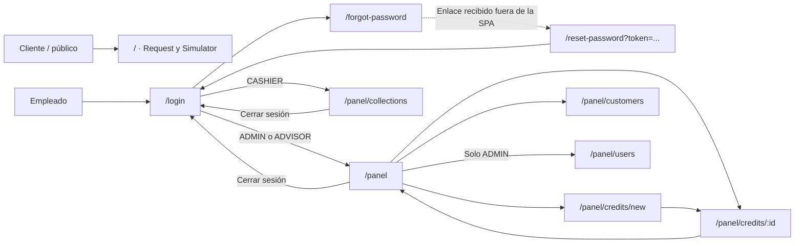

# Proyecto Final – Ingeniería de Software II

**Sistema de Gestión de Créditos**

**Memoria técnica y funcional · Versión final · 20 de noviembre de 2026**

Desarrollamos una solución web para administrar clientes, solicitudes de crédito, evaluación, desembolso y recaudo de cuotas. Organizamos el trabajo en cuatro Sprints cerrados en Jira y aplicamos una separación de responsabilidades mediante los perfiles ADMIN, ADVISOR y CASHIER.

El [Frontend](https://credit-management-frontend.vercel.app/) y el [Backend](https://credit-management-backend.vercel.app/) están desplegados en Vercel. Utilizamos PostgreSQL en Supabase para el entorno desplegado y PostgreSQL local para desarrollo. Esta memoria presenta el alcance del MVP, el backlog, los criterios de calidad, la arquitectura, la API y la navegación del producto.

## 1. Descripción del problema y necesidad

Una operación de crédito necesita identificar al solicitante, registrar sus ingresos y contacto, evaluar solicitudes, establecer un cronograma y controlar cuánto se ha recibido de cada cuota. La dispersión de esa información dificulta distinguir solicitudes pendientes de créditos desembolsados y pagos parciales de cuotas saldadas.

El sistema centraliza clientes por documento único, solicitudes con estados y cuotas asociadas. Separa responsabilidades internas mediante ADMIN, ADVISOR y CASHIER, expone una solicitud pública con simulador y registra cada pago con fecha y cajero. Su propósito es mejorar la trazabilidad operativa desde la solicitud hasta el recaudo. La reducción efectiva de tiempos y errores debe medirse en un piloto.

## 2. Usuario final: perfiles y permisos

| Perfil | Responsabilidad y permisos implementados en API | Acceso real en Frontend |
|---|---|---|
| ADMIN | Crear, listar y actualizar empleados; gestionar clientes; crear, listar y consultar créditos; aprobar/rechazar; desembolsar; consultar cuotas pendientes | Solicitudes, nueva solicitud, detalle, clientes y usuarios |
| ADVISOR | Crear, listar, consultar y actualizar clientes; crear/listar/consultar solicitudes; consultar cuotas pendientes | Solicitudes, nueva solicitud, detalle y clientes |
| CASHIER | Consultar cuotas pendientes y registrar pagos; también listar y crear clientes por permisos reales del Backend | Exclusivamente pantalla Cobros dentro del panel |
| Cliente final/prospecto | Simular y radicar solicitud pública sin token | Formulario público de tres pasos en `/`; no tiene cuenta ni panel propio |

El cliente es `Customer`, no un cuarto valor de `Role`. Los endpoints de autenticación son públicos para el equipo interno. ADMIN no hereda automáticamente todos los permisos: **solo CASHIER registra pagos**. `POST /customers` exige JWT y no usa `requireRoles`; permite acceso a los tres roles internos. La UI oculta funciones según sesión, pero la autorización efectiva ocurre en el servidor con el usuario y rol actuales consultados en BD.

## 3. Caso de uso principal: ciclo del crédito y recaudo

1. El cliente abre `/`, proporciona documento y nombres, contacto/ingresos y condiciones del crédito. El simulador consulta `POST /api/v1/credits/simulate` con amortización francesa y tasa fija mensual de 0.015.
2. El formulario radica `POST /api/v1/credits/public`. El servicio reutiliza al cliente existente sin modificar sus datos o crea uno nuevo, y registra solicitud `PENDING`. La respuesta pública contiene solamente `id` y `status` dentro de `data`.
3. Alternativamente, ADMIN o ADVISOR busca/crea al cliente y radica una solicitud interna desde `/panel/credits/new` con `POST /credits`.
4. ADMIN consulta el detalle y evalúa la solicitud pendiente. Para aprobar, la cuota estimada debe ser menor o igual al 40% del ingreso mensual registrado. Para rechazar, debe indicar un motivo. Un incumplimiento de capacidad devuelve 400 y conserva PENDING; no rechaza automáticamente.
5. ADMIN desembolsa una solicitud APPROVED. Una transacción crea las cuotas y actualiza el crédito a DISBURSED. El término “desembolso” representa registro interno y cronograma; no hay transferencia bancaria integrada.
6. CASHIER inicia sesión y llega a `/panel/collections`. Consulta cuotas por documento mediante HU-16. Solo se recuperan créditos DISBURSED y cuotas PENDING, PARTIAL u OVERDUE, ordenadas por vencimiento dentro de cada crédito.
7. Selecciona una cuota, ingresa un abono o usa “Usar saldo completo”, revisa el diálogo y confirma HU-17. El Backend obtiene cashierId de la sesión, consulta el saldo y rechaza importes superiores al pendiente.
8. La transacción actualiza `paidAmount`/estado y crea `Payment`. Saldo positivo produce PARTIAL; saldo cero produce PAID. La UI muestra recibo JSON y vuelve a consultar cuotas. Las cuotas PAID dejan de aparecer en HU-16.

Pago total significa cancelar el saldo de **una cuota**. No existe endpoint de liquidación anticipada global del crédito ni distribución automática entre varias cuotas. El crédito mantiene DISBURSED aunque todas sus cuotas estén pagadas.

Flujos y persistencia: [diagramas](DIAGRAMS.md), [HU-16](use-cases/pendingInstallments.md) y [HU-17](use-cases/registerPayment.md).

## 4. Alcance: MVP y exclusiones

| Incluido en el MVP | Fuera del alcance del MVP |
|---|---|
| Login, JWT, roles y usuarios activos/inactivos | MFA, refresh tokens, logout de servidor, auditoría integral |
| Recuperación y restablecimiento con correo en producción | Servicio genérico configurable de SMTP; usa Gmail |
| Clientes CC, CE y PASSPORT; documento único | Portal autenticado del cliente, KYC o consulta a centrales de riesgo |
| Solicitud pública e interna y simulador | Firma digital, adjuntos, garantías, codeudores |
| Evaluación manual y regla de capacidad del 40% | Scoring automático, tasas configurables, productos financieros múltiples |
| Desembolso lógico y cronograma persistido | Transferencias, integración bancaria y conciliación de pasarelas |
| Recaudo por cuota, abonos, saldo y recibo en pantalla | PDF, reversos, devoluciones, abono global o prepago de crédito |
| PostgreSQL mediante Prisma y Dockerfile | Multiempresa, facturación SaaS, reportes contables, alta disponibilidad y acuerdos de nivel de servicio |
| UI React con rutas protegidas y estados de carga/error; despliegue Vercel/Supabase | Automatización de pruebas y pipeline de análisis de calidad |

El modelo contempla OVERDUE para representar cuotas vencidas. La clasificación automática por fecha y el cálculo de intereses de mora se reservan para la evolución del módulo de cartera.

## 5. Product Backlog: épicas e historias

Gestionamos el backlog en Jira mediante cinco épicas y 17 historias de usuario. Las HU se encuentran finalizadas y distribuidas en cuatro Sprints. La tabla reúne su identificación, alcance, criterios de aceptación y estimación de esfuerzo relativo.

### Épicas del proyecto

| Clave Jira | Épica |
|---|---|
| SCRUM-1 | Gestión de Identidad y Accesos |
| SCRUM-2 | Administración de Clientes |
| SCRUM-3 | Originación y Evaluación de Créditos |
| SCRUM-4 | Liquidación y Planes de Pago |
| SCRUM-5 | Control de Recaudos y Cartera |

### Historias y criterios verificables

Utilizamos la escala Fibonacci de **3, 5 y 8 Story Points** para expresar el esfuerzo relativo de las historias. Los valores de la tabla corresponden a las estimaciones del proyecto y no representan horas ni mediciones de velocidad.

| Clave Jira | HU | Título en Jira | Épica / Principal | Sprint | Estado | Criterios de aceptación | SP |
|---|---|---|---|---|---|---|---|
| SCRUM-7 | HU-01 | Inicio de Sesión (Login) y Generación de Token | SCRUM-1 | SCRUM Sprint 1 | Finalizada | Credenciales válidas devuelven JWT de 2 h y usuario; inactivo o credenciales erróneas devuelven 401; CASHIER llega a Cobros | 8 |
| SCRUM-6 | HU-02 | Registro de Personal y Asignación de Roles | SCRUM-1 | SCRUM Sprint 1 | Finalizada | POST users con ADMIN devuelve 201 sin hash; rol no autorizado recibe 403; correo existente 409; contraseña requiere 8 caracteres, mayúscula y número | 5 |
| SCRUM-8 | HU-03 | Protección de Endpoints y Middleware de Roles | SCRUM-1 | SCRUM Sprint 1 | Finalizada | Sin Bearer o con token inválido/expirado devuelve 401; usuario inactivo pierde acceso; rol no permitido recibe 403; el middleware usa el usuario y rol actuales de BD. | 8 |
| SCRUM-9 | HU-04 | Gestión y Desactivación de Empleados | SCRUM-1 | SCRUM Sprint 1 | Finalizada | PATCH permite name, role, status; al menos un campo; empleado inexistente 404; autodesactivación 400; inactivo pierde acceso protegido | 5 |
| SCRUM-11 | HU-05 | Búsqueda y Perfilamiento de Cliente | SCRUM-2 | SCRUM Sprint 2 | Finalizada | Documento normalizado; devuelve datos en data; inexistente 404; formato inválido 400 | 5 |
| SCRUM-10 | HU-06 | Registro de Nuevo Cliente | SCRUM-2 | SCRUM Sprint 2 | Finalizada | Documento único; ingreso positivo; teléfono de 7–15 dígitos; 201 con cliente; duplicado detectado 409; UI ofrece alta a ADMIN/ADVISOR | 8 |
| SCRUM-12 | HU-07 | Actualización de Perfil y Datos de Contacto | SCRUM-2 | SCRUM Sprint 2 | Finalizada | Al menos monthlyIncome, address o phone; documento/tipo inmutables; ingreso positivo y teléfono válido; respuesta 200 | 8 |
| SCRUM-13 | HU-08 | Crear Solicitud de Crédito | SCRUM-3 | SCRUM Sprint 3 | Finalizada | Cliente existente; monto positivo hasta 100 millones; plazo entero 1–72; destino obligatorio; crea PENDING con 201 | 5 |
| SCRUM-14 | HU-09 | Evaluación de Solicitud de Crédito | SCRUM-3 | SCRUM Sprint 3 | Finalizada | Solo PENDING; APPROVED exige cuota <= 40% del ingreso; REJECTED exige motivo; reevaluación devuelve 400; ADVISOR obtiene 403 | 8 |
| SCRUM-15 | HU-10 | Consulta y Listado de Solicitudes | SCRUM-3 | SCRUM Sprint 3 | Finalizada | Filtros status/documentNumber en API; estado inválido 400; UI filtra estado y busca nombre/documento localmente; listado vacío es válido | 3 |
| SCRUM-16 | HU-11 | Simulación de Tabla de Amortización | SCRUM-4 | SCRUM Sprint 3 | Finalizada | Monto positivo y plazo entero 1–72; francés al 1.5% mensual; devuelve cuota, intereses, total y schedule sin persistir | 5 |
| SCRUM-17 | HU-12 | Liquidación y Activación del Crédito | SCRUM-4 | SCRUM Sprint 3 | Finalizada | Solo APPROVED; crea cronograma y DISBURSED en transacción; cuotas PENDING y paidAmount 0; estado diferente devuelve 400 | 5 |
| SCRUM-39 | HU-13 | Formulario Web Público para Radicación de Créditos por el Cliente | SCRUM-3 | SCRUM Sprint 3 | Finalizada | Formulario de tres pasos; monto 100 mil–100 millones y plazo 1–72; crea/reutiliza cliente; devuelve id/status PENDING; datos existentes no se sobrescriben | 5 |
| SCRUM-41 | HU-14 | Consulta de Detalle de Solicitud de Crédito | SCRUM-3 | SCRUM Sprint 3 | Finalizada | Devuelve solicitud, proyección de cliente y cuotas por número; inexistente 404; UI habilita decisión/desembolso solo a ADMIN según estado | 3 |
| SCRUM-42 | HU-15 | Olvidar Contraseña | Sin épica vinculada | SCRUM Sprint 4 | Finalizada | Correo registrado activo genera enlace de 15 min; correo ausente tiene respuesta genérica; token inválido/usado devuelve 400; contraseña cambia con hash | 8 |
| SCRUM-18 | HU-16 | Consulta de Cuotas Pendientes | SCRUM-5 | SCRUM Sprint 4 | Finalizada | Busca cliente normalizado; ausente 404; solo DISBURSED y cuotas PENDING/PARTIAL/OVERDUE; devuelve pendingBalance y etiqueta de estado | 3 |
| SCRUM-19 | HU-17 | Registro de Pago de Cuota | SCRUM-5 | SCRUM Sprint 4 | Finalizada | 201 con receipt; monto positivo hasta saldo; inexistente 404; ya pagada o sobrepago 400; cajero de JWT; update y Payment atómicos; saldo final define PARTIAL/PAID | 5 |

HU-15 (SCRUM-42) gestiona la recuperación de contraseña y se mantiene sin una épica vinculada en Jira. Los listados de usuarios/clientes y health son operaciones de apoyo. HU-03 define la política transversal de autenticación y autorización de las rutas protegidas.

Dependencias funcionales: identidad habilita las operaciones protegidas; el cliente precede a la solicitud interna; HU-09 precede a HU-12 y el desembolso habilita el recaudo HU-16/HU-17.

**Estimación total del backlog: 97 SP.**

## 6. Definition of Done técnico y funcional

Aplicamos los siguientes criterios para considerar una historia lista para aceptación:

- **Funcionalidad:** el flujo principal cumple los criterios de aceptación y contempla entradas inválidas, recursos inexistentes y reglas de negocio.
- **Seguridad:** la operación exige autenticación y rol cuando corresponde; los errores diferencian 401 y 403; las respuestas no exponen hashes ni secretos.
- **Interfaz:** el usuario puede completar la tarea desde su perfil y recibe estados de carga, vacío, validación, éxito y error.
- **Persistencia:** las relaciones y restricciones son coherentes con el modelo Prisma; las operaciones de desembolso y pago mantienen atomicidad en sus escrituras.
- **Verificación:** se revisan los escenarios positivos y negativos en el entorno de pruebas y se conserva su resultado junto con la historia. La compilación y la validación del esquema forman parte de la revisión técnica.
- **Versionamiento:** el cambio se revisa en Git y las modificaciones de estructura se acompañan de sus migraciones.
- **Documentación:** el contrato API, la navegación y los diagramas reflejan el comportamiento entregado.
- **Aceptación:** el equipo revisa el incremento con los criterios de la historia y mantiene su seguimiento en Jira.

El DoD establece los criterios de calidad del proceso. Las pruebas manuales, la automatización y el análisis estático se gestionan como actividades diferenciadas; un estado de historia finalizada no sustituye un reporte de cobertura.

## 7. Resumen de cuatro Sprints

Completamos cuatro Sprints con **17 HU finalizadas**. La distribución de historias se mantiene alineada con Jira; los SP corresponden a las estimaciones del proyecto.

| Sprint | Objetivo | Historias finalizadas | Cantidad | SP estimados | Estado |
|---|---|---|---|---|---|
| SCRUM Sprint 1 | Identidad y control de acceso | HU-01, HU-02, HU-03, HU-04 | 4 | 26 | Cerrado |
| SCRUM Sprint 2 | Administración de clientes | HU-05, HU-06, HU-07 | 3 | 21 | Cerrado |
| SCRUM Sprint 3 | Originación, evaluación y liquidación | HU-08, HU-09, HU-10, HU-11, HU-12, HU-13, HU-14 | 7 | 34 | Cerrado |
| SCRUM Sprint 4 | Recuperación de acceso y recaudo | HU-15, HU-16, HU-17 | 3 | 16 | Cerrado |
| **Total** | **MVP de gestión de créditos** | **HU-01 a HU-17** | **17** | **97** | **Completado** |

### Sprint Review: incrementos entregados

| Sprint | Incremento funcional | Recorrido de revisión |
|---|---|---|
| 1 | Inicio de sesión, registro de personal, JWT/RBAC y gestión de empleados | Acceder por rol, crear un empleado, editarlo y comprobar el bloqueo de acceso de cuentas inactivas |
| 2 | Búsqueda, registro y actualización de clientes | Buscar por documento, registrar un cliente y actualizar ingresos y contacto |
| 3 | Solicitudes internas/públicas, evaluación, listados, simulación, desembolso y detalle | Radicar, consultar, aprobar o rechazar; simular el plan y generar las cuotas del crédito aprobado |
| 4 | Recuperación de contraseña, consulta de cuotas y pagos | Restablecer acceso, buscar cuotas por documento, registrar un abono y pagar el saldo de una cuota |

### Sprint Retrospective: aprendizajes y acciones de mejora

| Sprint | Aprendizaje del incremento | Acción de mejora |
|---|---|---|
| 1 | La identidad y los permisos son una dependencia transversal | Mantener una matriz de roles y escenarios de rechazo para cada operación protegida |
| 2 | La identidad del cliente debe conservarse entre operaciones | Centralizar validación y normalización de documentos y verificar la persistencia de los campos editables |
| 3 | El ciclo financiero conecta reglas, estados y persistencia | Revisar transiciones de estado, redondeo y atomicidad antes de extender el producto |
| 4 | El recaudo exige trazabilidad y control de reintentos | Fortalecer idempotencia, pruebas concurrentes y conciliación entre pagos y saldo acumulado |

El seguimiento de implementación incluye la validación manual de respuestas HTTP en Postman (SCRUM-38) y la sincronización del esquema en local y Supabase (SCRUM-46).

## 8. Lecciones aprendidas

1. **Responsabilidades por rol:** una matriz explícita evita que los permisos de administración se interpreten como acceso universal a las operaciones financieras.
2. **Transacciones y concurrencia:** agrupar las escrituras de un pago protege su atomicidad; la evolución del recaudo también debe controlar operaciones simultáneas y reintentos.
3. **Versionamiento de datos:** mantener esquema y migraciones juntos facilita instalaciones reproducibles y consistencia entre desarrollo y despliegue.
4. **Validación en ejecución:** los tipos TypeScript deben complementarse con validación de los datos HTTP y reglas de negocio explícitas.
5. **Contrato compartido:** documentar API e interfaz conjuntamente permite alinear campos, mensajes y permisos.
6. **Configuración por entorno:** separar secretos y parámetros operativos facilita el despliegue y el mantenimiento.
7. **Trazabilidad de trabajo:** vincular HU, cambios de Git y verificaciones permite explicar cada incremento y su alcance.

## 9. Riesgos y mitigaciones

| Riesgo arquitectónico u operativo | Impacto | Mitigación y verificación |
|---|---|---|
| Concurrencia en recaudo y desembolso | Operaciones simultáneas pueden competir por el mismo saldo o transición de estado | Complementar las transacciones con control de concurrencia, condiciones de actualización o aislamiento apropiado; probar solicitudes simultáneas y conciliar resultados |
| Reintentos e idempotencia | Un reenvío tras un timeout puede duplicar una operación financiera | Incorporar claves de idempotencia persistidas y respuestas reutilizables; verificar reenvíos desde distintos clientes |
| Precisión decimal de importes | Los cálculos en punto flotante pueden acumular diferencias de redondeo | Evolucionar a Decimal o unidades monetarias menores; establecer política de redondeo y verificar acumulados y última cuota |
| Rate limiting y capacidad de servicio | Solicitudes masivas a login, recuperación o rutas públicas pueden degradar disponibilidad | Definir límites por origen y operación, cuotas de tráfico y alertas; realizar pruebas controladas de carga y de rechazo por límite |
| Respaldos y recuperación | Una pérdida de datos o indisponibilidad afecta la continuidad operativa | Establecer frecuencia de respaldo, retención, RPO/RTO y responsables; ensayar restauración y comprobar integridad de clientes, créditos, cuotas y pagos |

Las mitigaciones forman parte del fortalecimiento operativo del producto y se priorizan según volumen, criticidad y resultados de las verificaciones.

## 10. Estudio de mercado y soluciones similares

Comparación exploratoria, consultada el 19 de noviembre de 2026 en fuentes oficiales. No sustituye entrevistas, cotizaciones ni un estudio cuantitativo de demanda.

| Alternativa | Capacidades publicadas / observadas | Diferencia relevante frente al proyecto |
|---|---|---|
| Mifos X | Plataforma abierta con gestión de clientes, cartera de préstamos/ahorro, contabilidad y reportes | Cobertura más amplia; este proyecto reduce alcance a originación y recaudo de créditos individuales |
| Mambu | Productos y cuentas de préstamo configurables; intereses, cronogramas, pagos y ciclo del crédito | Mayor configurabilidad e integración; el MVP tiene una tasa y reglas fijas, sin motor de productos |
| Hoja de cálculo / operación manual | Alternativa conceptual; no se estudió un producto concreto ni una organización usuaria | Menor barrera inicial; el MVP agrega control por rol, relaciones persistidas y recibo vinculado a cajero |
| Sistema construido | Cinco modelos, 20 operaciones HTTP, tres roles y diez rutas Frontend | Prototipo enfocado para validación; no equiparable aún a un core financiero completo |

Fuentes: [Mifos X](https://mifos.org/mifos-x/) y [documentación oficial de préstamos Mambu](https://docs.mambu.com/docs/loans-overview/). La diferenciación propuesta es una experiencia simple para operaciones pequeñas; su valor y disposición a pagar están pendientes de validación. La validación comercial comprende entrevistas, pruebas de adopción y análisis de costos.

## 11. Modelo de monetización: SaaS B2B

**Modelo comercial propuesto.** Cliente objetivo: cooperativas y pequeñas financieras que necesitan originación y control de recaudo. El ingreso provendría de suscripción por organización, con escalones por usuarios operativos o cartera administrada y un cargo opcional de implementación/migración. Los precios se definirían mediante entrevistas y costos reales, con base en la disposición de pago y los costos de operación.

| Nivel propuesto | Oferta futura | Condición para ofrecerla |
|---|---|---|
| Piloto | Acompañamiento, instancia aislada, funcionalidades verificadas del MVP | Respaldo/restauración, migraciones completas y contrato de soporte |
| Operación | Mayor volumen y soporte con horario definido | Observabilidad, pruebas y objetivos de servicio medidos |
| Integración | Integraciones, reportes y personalización | Requerimientos aprobados y costo estimado por alcance |

Costos por estimar: hosting, PostgreSQL, backups, correo, soporte, onboarding, seguridad y desarrollo. Indicadores propuestos: MRR, margen por organización, costo de adquisición, conversión de piloto a pago, retención y cancelación. Punto de equilibrio = costos fijos / contribución media por organización, cuando existan datos. El esquema actual no contiene tenant, plan, factura ni suscripción; inicialmente cualquier piloto multiinstitución exigiría aislamiento explícito.

## 12. Estrategia de visibilidad y adopción

Estrategia propuesta: presentar una demo con datos sintéticos y recorrido por rol; publicar README, diagramas y contrato OpenAPI; contactar cooperativas mediante canales institucionales autorizados; organizar pilotos supervisados y capacitación para asesor, administrador y cajero.

La adopción comienza con diagnóstico del proceso y calidad de documentos, continúa con provisión de usuarios y carga validada de clientes, y termina con operaciones acompañadas y conciliación diaria de pagos. El MVP no incluye importador masivo; una migración real necesita procedimiento específico.

Medir prospectos calificados, demos, pilotos iniciados, usuarios activos por rol, tiempo desde solicitud a decisión, tiempo de registro de pago, errores y satisfacción. Establecer línea base en el piloto antes de prometer ahorros. Condición de expansión: aceptación funcional, datos conciliados, restauración comprobada y ausencia de defectos críticos.

## 13. Roadmap post-MVP

| Fase propuesta | Resultado | Criterio de salida / dependencia |
|---|---|---|
| 1. Estabilización | Migraciones completas, validaciones coherentes, alineación UI/API, pruebas de recaudo y corrección de carreras | BD reconstruible; contratos verificados; concurrencia e idempotencia probadas |
| 2. Piloto operativo | Consolidar operación en Vercel/Supabase con backups, monitoreo, soporte y capacitación | Smoke test por rol, restauración y conciliación; decisión del responsable del piloto |
| 3. Gestión de cartera | Reportes, vencimiento automático, cierre de crédito y recibos exportables | Reglas de mora/cierre aceptadas y pruebas; no basta con agregar estados |
| 4. Integraciones | Pasarela/bancos, notificaciones y auditoría | Proveedores y contratos aprobados; trazabilidad y conciliación end-to-end |
| 5. SaaS B2B | Aislamiento multiempresa, planes y facturación | Modelo de tenant, pruebas de aislamiento y viabilidad comercial |

No son fechas comprometidas. Cada fase requiere priorización, estimación y validación con usuarios; ninguna se presenta como ya disponible.

## 14. Documentación de API REST

La referencia siguiente incluye las **20 operaciones reales**, prefijo compuesto `/api/v1`, métodos, roles, requests, responses y errores por operación. OpenAPI importable: [openapi.yaml](openapi.yaml). Los ejemplos JSON utilizan datos de demostración. Headers: `Content-Type: application/json` para body y `Authorization: Bearer <token>` en rutas protegidas. No todas las operaciones devuelven todos los códigos: 200/201 corresponden al éxito propio, 400 a validaciones, 401 a autenticación, 403 a RBAC, 404 a recursos/rutas inexistentes y 500 a fallos internos. Se conserva además 409 donde está implementado.


Los ejemplos JSON muestran los contratos de entrada y salida de cada operación. Las respuestas mantienen los campos definidos por cada controlador.

| Método | Ruta (prefijo `/api/v1`) | Acceso real | Éxito | Errores documentados |
|---|---|---|---|---|
| GET | `/health` | Público | 200 | — |
| POST | `/auth/login` | Público | 200 | 400, 401 |
| POST | `/auth/forgot-password` | Público | 200 | 400, 500 |
| POST | `/auth/reset-password` | Público | 200 | 400, 500 |
| POST | `/users` | ADMIN | 201 | 400, 401, 403, 409, 500 |
| PATCH | `/users/{id}` | ADMIN | 200 | 400, 401, 403, 404, 500 |
| GET | `/users` | ADMIN | 200 | 401, 403, 500 |
| POST | `/customers` | ADMIN, ADVISOR, CASHIER | 201 | 400, 401, 409, 500 |
| GET | `/customers/by-document/{documentNumber}` | ADMIN, ADVISOR | 200 | 400, 401, 403, 404, 500 |
| PATCH | `/customers/by-document/{documentNumber}` | ADMIN, ADVISOR | 200 | 400, 401, 403, 404, 500 |
| GET | `/customers` | ADMIN, ADVISOR, CASHIER | 200 | 401, 403, 500 |
| POST | `/credits/simulate` | Público | 200 | 400, 500 |
| POST | `/credits/public` | Público | 201 | 400, 500 |
| POST | `/credits` | ADMIN, ADVISOR | 201 | 400, 401, 403, 404, 500 |
| PATCH | `/credits/{id}/evaluate` | ADMIN | 200 | 400, 401, 403, 404, 500 |
| GET | `/credits` | ADMIN, ADVISOR | 200 | 400, 401, 403, 500 |
| POST | `/credits/{id}/disburse` | ADMIN | 200 | 400, 401, 403, 404, 500 |
| GET | `/credits/{id}` | ADMIN, ADVISOR | 200 | 400, 401, 403, 404, 500 |
| GET | `/collections/customers/{documentNumber}/pending-installments` | ADMIN, ADVISOR, CASHIER | 200 | 400, 401, 403, 404, 500 |
| POST | `/collections/payments` | CASHIER | 201 | 400, 401, 403, 404, 500 |

En body malformado: ```json
{
  "status": "error",
  "message": "El cuerpo de la petición (JSON) está malformado o es inválido"
}
```

Errores de aplicación: ```json
{
  "success": false,
  "message": "Descripción del error"
}
```

Un 404 por ruta no registrada usa el mensaje `Ruta no encontrada: METHOD URL`. CORS rechazado llega al manejador global como 500; no equivale a autorización RBAC. 409 existe en altas de usuarios/clientes aunque no figuraba en la lista solicitada. Un 500 puede ocurrir en infraestructura; login y verifyToken convierten sus excepciones capturadas a 401.

#### GET /api/v1/health

Estado de API. No consulta la base de datos.

**Acceso:** público. 

**Request:** sin body.

**Response 200:**

```json
{
  "status": "API v1 is running "
}
```

**Errores:** Sin errores específicos de negocio definidos.

Contrato completo de campos y parámetros: [OpenAPI](openapi.yaml).

#### POST /api/v1/auth/login

Iniciar sesión. JWT de 2 horas con userId y role. Todos los errores capturados por este controlador se convierten en 401.

**Acceso:** público. Header: `Content-Type: application/json`.

**Request:** 

```json
{
  "email": "admin@example.com",
  "password": "DemoPass123"
}
```

**Response 200:**

```json
{
  "success": true,
  "message": "Login exitoso",
  "data": {
    "token": "<JWT>",
    "user": {
      "id": 1,
      "name": "Ana Administradora",
      "email": "admin@example.com",
      "role": "ADMIN",
      "status": "ACTIVE",
      "createdAt": "2026-11-19T15:00:00.000Z"
    }
  }
}
```

**Errores:** 400: Validación o regla de negocio incumplida; JSON malformado. 401: Token ausente, inválido o expirado; usuario inexistente/inactivo; credenciales inválidas en login.

Contrato completo de campos y parámetros: [OpenAPI](openapi.yaml).

#### POST /api/v1/auth/forgot-password

Solicitar recuperación. Respuesta genérica para correo inexistente o inactivo; JWT de recuperación de 15 minutos. SMTP solo en NODE_ENV=production.

**Acceso:** público. Header: `Content-Type: application/json`.

**Request:** 

```json
{
  "email": "admin@example.com"
}
```

**Response 200:**

```json
{
  "success": true,
  "message": "Si el correo se encuentra registrado, recibirás un enlace para restablecer tu contraseña."
}
```

**Errores:** 400: Validación o regla de negocio incumplida; JSON malformado. 500: Error interno, persistencia o configuración.

Contrato completo de campos y parámetros: [OpenAPI](openapi.yaml).

#### POST /api/v1/auth/reset-password

Restablecer contraseña. Secreto dinámico JWT_SECRET + passwordHash: cambiar la contraseña invalida el enlace. La regla aquí es longitud mínima 8, distinta de alta de usuarios.

**Acceso:** público. Header: `Content-Type: application/json`.

**Request:** 

```json
{
  "token": "<RESET_JWT>",
  "newPassword": "NuevaPass123"
}
```

**Response 200:**

```json
{
  "success": true,
  "message": "Contraseña restablecida exitosamente. Ya puedes iniciar sesión."
}
```

**Errores:** 400: Validación o regla de negocio incumplida; JSON malformado. 500: Error interno, persistencia o configuración.

Contrato completo de campos y parámetros: [OpenAPI](openapi.yaml).

#### POST /api/v1/users

Crear empleado. 

**Acceso:** ADMIN. Header: `Authorization: Bearer <token>`. Header: `Content-Type: application/json`.

**Request:** 

```json
{
  "name": "Carlos Cajero",
  "email": "cashier@example.com",
  "password": "DemoPass123",
  "role": "CASHIER"
}
```

**Response 201:**

```json
{
  "success": true,
  "message": "User created successfully",
  "data": {
    "id": 2,
    "name": "Carlos Cajero",
    "email": "cashier@example.com",
    "role": "CASHIER",
    "status": "ACTIVE",
    "createdAt": "2026-11-19T15:00:00.000Z"
  }
}
```

**Errores:** 400: Validación o regla de negocio incumplida; JSON malformado. 401: Token ausente, inválido o expirado; usuario inexistente/inactivo; credenciales inválidas en login. 403: Rol actual sin autorización. 409: Correo o documento ya registrado. 500: Error interno, persistencia o configuración.

Contrato completo de campos y parámetros: [OpenAPI](openapi.yaml).

#### PATCH /api/v1/users/{id}

Actualizar empleado. Impide la autodesactivación; permite cambiar name, role, status.

**Acceso:** ADMIN. Header: `Authorization: Bearer <token>`. Header: `Content-Type: application/json`.

**Request:** 

```json
{
  "name": "Carlos Cajero",
  "status": "INACTIVE"
}
```

**Response 200:**

```json
{
  "success": true,
  "message": "Empleado actualizado exitosamente",
  "data": {
    "id": 2,
    "name": "Carlos Cajero",
    "email": "admin@example.com",
    "role": "CASHIER",
    "status": "INACTIVE",
    "createdAt": "2026-11-19T15:00:00.000Z"
  }
}
```

**Errores:** 400: Validación o regla de negocio incumplida; JSON malformado. 401: Token ausente, inválido o expirado; usuario inexistente/inactivo; credenciales inválidas en login. 403: Rol actual sin autorización. 404: Recurso inexistente. 500: Error interno, persistencia o configuración.

Contrato completo de campos y parámetros: [OpenAPI](openapi.yaml).

#### GET /api/v1/users

Listar empleados. Orden descendente por createdAt; sin paginación.

**Acceso:** ADMIN. Header: `Authorization: Bearer <token>`. 

**Request:** sin body.

**Response 200:**

```json
{
  "success": true,
  "data": [
    {
      "id": 1,
      "name": "Ana Administradora",
      "email": "admin@example.com",
      "role": "ADMIN",
      "status": "ACTIVE",
      "createdAt": "2026-11-19T15:00:00.000Z"
    }
  ]
}
```

**Errores:** 401: Token ausente, inválido o expirado; usuario inexistente/inactivo; credenciales inválidas en login. 403: Rol actual sin autorización. 500: Error interno, persistencia o configuración.

Contrato completo de campos y parámetros: [OpenAPI](openapi.yaml).

#### POST /api/v1/customers

Registrar cliente. Solo verifyToken: no hay restricción RBAC adicional. CC/CE: 6–10 dígitos; PASSPORT: 6–12 alfanuméricos. Teléfono: 7–15 dígitos.

**Acceso:** ADMIN, ADVISOR, CASHIER. Header: `Authorization: Bearer <token>`. Header: `Content-Type: application/json`.

**Request:** 

```json
{
  "documentType": "CC",
  "documentNumber": "1234567890",
  "firstName": "Laura",
  "lastName": "Pérez",
  "monthlyIncome": 3000000,
  "address": "Calle 10 # 20-30",
  "phone": "3001234567"
}
```

**Response 201:**

```json
{
  "message": "Cliente registrado exitosamente",
  "data": {
    "id": 1,
    "documentType": "CC",
    "documentNumber": "1234567890",
    "firstName": "Laura",
    "lastName": "Pérez",
    "monthlyIncome": 3000000,
    "address": "Calle 10 # 20-30",
    "phone": "3001234567",
    "createdAt": "2026-11-19T15:00:00.000Z",
    "updatedAt": "2026-11-19T15:00:00.000Z"
  }
}
```

**Errores:** 400: Validación o regla de negocio incumplida; JSON malformado. 401: Token ausente, inválido o expirado; usuario inexistente/inactivo; credenciales inválidas en login. 409: Correo o documento ya registrado. 500: Error interno, persistencia o configuración.

Contrato completo de campos y parámetros: [OpenAPI](openapi.yaml).

#### GET /api/v1/customers/by-document/{documentNumber}

Consultar cliente. 

**Acceso:** ADMIN, ADVISOR. Header: `Authorization: Bearer <token>`. 

**Request:** sin body.

**Response 200:**

```json
{
  "data": {
    "id": 1,
    "documentType": "CC",
    "documentNumber": "1234567890",
    "firstName": "Laura",
    "lastName": "Pérez",
    "monthlyIncome": 3000000,
    "address": "Calle 10 # 20-30",
    "phone": "3001234567",
    "createdAt": "2026-11-19T15:00:00.000Z",
    "updatedAt": "2026-11-19T15:00:00.000Z"
  }
}
```

**Errores:** 400: Validación o regla de negocio incumplida; JSON malformado. 401: Token ausente, inválido o expirado; usuario inexistente/inactivo; credenciales inválidas en login. 403: Rol actual sin autorización. 404: Recurso inexistente. 500: Error interno, persistencia o configuración.

Contrato completo de campos y parámetros: [OpenAPI](openapi.yaml).

#### PATCH /api/v1/customers/by-document/{documentNumber}

Actualizar cliente. 

**Acceso:** ADMIN, ADVISOR. Header: `Authorization: Bearer <token>`. Header: `Content-Type: application/json`.

**Request:** 

```json
{
  "phone": "3007654321",
  "monthlyIncome": 3500000
}
```

**Response 200:**

```json
{
  "message": "Datos del cliente actualizados exitosamente",
  "data": {
    "id": 1,
    "documentType": "CC",
    "documentNumber": "1234567890",
    "firstName": "Laura",
    "lastName": "Pérez",
    "monthlyIncome": 3500000,
    "address": "Calle 10 # 20-30",
    "phone": "3007654321",
    "createdAt": "2026-11-19T15:00:00.000Z",
    "updatedAt": "2026-11-19T15:00:00.000Z"
  }
}
```

**Errores:** 400: Validación o regla de negocio incumplida; JSON malformado. 401: Token ausente, inválido o expirado; usuario inexistente/inactivo; credenciales inválidas en login. 403: Rol actual sin autorización. 404: Recurso inexistente. 500: Error interno, persistencia o configuración.

Contrato completo de campos y parámetros: [OpenAPI](openapi.yaml).

#### GET /api/v1/customers

Listar clientes. Orden descendente por createdAt; sin paginación.

**Acceso:** ADMIN, ADVISOR, CASHIER. Header: `Authorization: Bearer <token>`. 

**Request:** sin body.

**Response 200:**

```json
{
  "data": [
    {
      "id": 1,
      "documentType": "CC",
      "documentNumber": "1234567890",
      "firstName": "Laura",
      "lastName": "Pérez",
      "monthlyIncome": 3000000,
      "address": "Calle 10 # 20-30",
      "phone": "3001234567",
      "createdAt": "2026-11-19T15:00:00.000Z",
      "updatedAt": "2026-11-19T15:00:00.000Z"
    }
  ]
}
```

**Errores:** 401: Token ausente, inválido o expirado; usuario inexistente/inactivo; credenciales inválidas en login. 403: Rol actual sin autorización. 500: Error interno, persistencia o configuración.

Contrato completo de campos y parámetros: [OpenAPI](openapi.yaml).

#### POST /api/v1/credits/simulate

Simular amortización. Sistema francés, tasa mensual fija 1.5%. Convierte amount y termMonths con Number; no impone el máximo de monto de creación.

**Acceso:** público. Header: `Content-Type: application/json`.

**Request:** 

```json
{
  "amount": 100000,
  "termMonths": 1
}
```

**Response 200:**

```json
{
  "message": "Simulación del plan de amortización realizada exitosamente",
  "data": {
    "amount": 100000,
    "termMonths": 1,
    "monthlyInterestRate": 0.015,
    "monthlyInstallment": 101500,
    "totalInterest": 1500,
    "totalPayment": 101500,
    "schedule": [
      {
        "installmentNumber": 1,
        "payment": 101500,
        "interest": 1500,
        "principal": 100000,
        "remainingBalance": 0
      }
    ]
  }
}
```

**Errores:** 400: Validación o regla de negocio incumplida; JSON malformado. 500: Error interno, persistencia o configuración.

Contrato completo de campos y parámetros: [OpenAPI](openapi.yaml).

#### POST /api/v1/credits/public

Solicitar crédito público. Crea cliente si no existe; si existe no modifica sus datos. documentType=CC, address=No registrada, phone vacío y destination=Libre inversión por defecto. Cliente y solicitud se crean sin transacción conjunta.

**Acceso:** público. Header: `Content-Type: application/json`.

**Request:** 

```json
{
  "documentType": "CC",
  "documentNumber": "1234567890",
  "firstName": "Laura",
  "lastName": "Pérez",
  "monthlyIncome": 3000000,
  "address": "Calle 10 # 20-30",
  "phone": "3001234567",
  "amount": 100000,
  "termMonths": 1,
  "destination": "Capital de trabajo"
}
```

**Response 201:**

```json
{
  "message": "Solicitud de crédito registrada exitosamente. Ha quedado en estado PENDIENTE de evaluación.",
  "data": {
    "id": 1,
    "status": "PENDING"
  }
}
```

**Errores:** 400: Validación o regla de negocio incumplida; JSON malformado. 500: Error interno, persistencia o configuración.

Contrato completo de campos y parámetros: [OpenAPI](openapi.yaml).

#### POST /api/v1/credits

Crear solicitud interna. Documento alfanumérico de 5–20 caracteres; cliente debe existir. Monto positivo hasta 100000000, plazo entero de 1–72.

**Acceso:** ADMIN, ADVISOR. Header: `Authorization: Bearer <token>`. Header: `Content-Type: application/json`.

**Request:** 

```json
{
  "documentNumber": "1234567890",
  "amount": 100000,
  "termMonths": 1,
  "destination": "Capital de trabajo"
}
```

**Response 201:**

```json
{
  "message": "Solicitud de crédito creada exitosamente en estado Pendiente",
  "data": {
    "id": 1,
    "amount": 100000,
    "termMonths": 1,
    "destination": "Capital de trabajo",
    "status": "PENDING",
    "rejectionReason": null,
    "customerId": 1,
    "createdAt": "2026-11-19T15:00:00.000Z",
    "updatedAt": "2026-11-19T15:00:00.000Z",
    "customer": {
      "documentNumber": "1234567890",
      "firstName": "Laura",
      "lastName": "Pérez"
    }
  }
}
```

**Errores:** 400: Validación o regla de negocio incumplida; JSON malformado. 401: Token ausente, inválido o expirado; usuario inexistente/inactivo; credenciales inválidas en login. 403: Rol actual sin autorización. 404: Recurso inexistente. 500: Error interno, persistencia o configuración.

Contrato completo de campos y parámetros: [OpenAPI](openapi.yaml).

#### PATCH /api/v1/credits/{id}/evaluate

Evaluar solicitud. Solo PENDING; rechazo exige rejectionReason no vacío; aprobación exige cuota francesa <= 40% de monthlyIncome.

**Acceso:** ADMIN. Header: `Authorization: Bearer <token>`. Header: `Content-Type: application/json`.

**Request:** 

```json
{
  "status": "APPROVED"
}
```

**Response 200:**

```json
{
  "message": "Solicitud de crédito evaluada exitosamente: APPROVED",
  "data": {
    "id": 1,
    "amount": 100000,
    "termMonths": 1,
    "destination": "Capital de trabajo",
    "status": "APPROVED",
    "rejectionReason": null,
    "customerId": 1,
    "createdAt": "2026-11-19T15:00:00.000Z",
    "updatedAt": "2026-11-19T15:00:00.000Z",
    "customer": {
      "documentNumber": "1234567890",
      "firstName": "Laura",
      "lastName": "Pérez",
      "monthlyIncome": 3000000
    }
  }
}
```

**Errores:** 400: Validación o regla de negocio incumplida; JSON malformado. 401: Token ausente, inválido o expirado; usuario inexistente/inactivo; credenciales inválidas en login. 403: Rol actual sin autorización. 404: Recurso inexistente. 500: Error interno, persistencia o configuración.

Contrato completo de campos y parámetros: [OpenAPI](openapi.yaml).

#### GET /api/v1/credits

Listar solicitudes. Filtros opcionales status y documentNumber; status se convierte a mayúsculas, documento solo trim. Orden descendente por createdAt.

**Acceso:** ADMIN, ADVISOR. Header: `Authorization: Bearer <token>`. 

**Request:** sin body.

**Response 200:**

```json
{
  "message": "Listado de solicitudes de crédito obtenido exitosamente",
  "count": 1,
  "data": [
    {
      "id": 1,
      "amount": 100000,
      "termMonths": 1,
      "destination": "Capital de trabajo",
      "status": "PENDING",
      "rejectionReason": null,
      "customerId": 1,
      "createdAt": "2026-11-19T15:00:00.000Z",
      "updatedAt": "2026-11-19T15:00:00.000Z",
      "customer": {
        "documentNumber": "1234567890",
        "firstName": "Laura",
        "lastName": "Pérez",
        "monthlyIncome": 3000000
      }
    }
  ]
}
```

**Errores:** 400: Validación o regla de negocio incumplida; JSON malformado. 401: Token ausente, inválido o expirado; usuario inexistente/inactivo; credenciales inválidas en login. 403: Rol actual sin autorización. 500: Error interno, persistencia o configuración.

Contrato completo de campos y parámetros: [OpenAPI](openapi.yaml).

#### POST /api/v1/credits/{id}/disburse

Desembolsar crédito. Solo APPROVED; transacción crea cuotas y cambia estado a DISBURSED. Fechas calculadas con Date.setMonth desde el día del desembolso. No ejecuta transferencia bancaria.

**Acceso:** ADMIN. Header: `Authorization: Bearer <token>`. 

**Request:** sin body.

**Response 200:**

```json
{
  "message": "Crédito liquidado y desembolsado exitosamente. Se ha generado el cronograma oficial de pagos.",
  "data": {
    "id": 1,
    "amount": 100000,
    "termMonths": 1,
    "destination": "Capital de trabajo",
    "status": "DISBURSED",
    "rejectionReason": null,
    "customerId": 1,
    "createdAt": "2026-11-19T15:00:00.000Z",
    "updatedAt": "2026-11-19T15:00:00.000Z",
    "customer": {
      "documentNumber": "1234567890",
      "firstName": "Laura",
      "lastName": "Pérez"
    },
    "installments": [
      {
        "id": 1,
        "installmentNumber": 1,
        "dueDate": "2026-12-19T15:00:00.000Z",
        "principal": 100000,
        "interest": 1500,
        "paidAmount": 0,
        "totalAmount": 101500,
        "status": "PENDING",
        "creditRequestId": 1,
        "createdAt": "2026-11-19T15:00:00.000Z",
        "updatedAt": "2026-11-19T15:00:00.000Z"
      }
    ]
  }
}
```

**Errores:** 400: Validación o regla de negocio incumplida; JSON malformado. 401: Token ausente, inválido o expirado; usuario inexistente/inactivo; credenciales inválidas en login. 403: Rol actual sin autorización. 404: Recurso inexistente. 500: Error interno, persistencia o configuración.

Contrato completo de campos y parámetros: [OpenAPI](openapi.yaml).

#### GET /api/v1/credits/{id}

Detalle de solicitud. 

**Acceso:** ADMIN, ADVISOR. Header: `Authorization: Bearer <token>`. 

**Request:** sin body.

**Response 200:**

```json
{
  "message": "Detalle de la solicitud de crédito obtenido exitosamente",
  "data": {
    "id": 1,
    "amount": 100000,
    "termMonths": 1,
    "destination": "Capital de trabajo",
    "status": "PENDING",
    "rejectionReason": null,
    "customerId": 1,
    "createdAt": "2026-11-19T15:00:00.000Z",
    "updatedAt": "2026-11-19T15:00:00.000Z",
    "customer": {
      "id": 1,
      "documentNumber": "1234567890",
      "firstName": "Laura",
      "lastName": "Pérez",
      "phone": "3001234567",
      "monthlyIncome": 3000000
    },
    "installments": []
  }
}
```

**Errores:** 400: Validación o regla de negocio incumplida; JSON malformado. 401: Token ausente, inválido o expirado; usuario inexistente/inactivo; credenciales inválidas en login. 403: Rol actual sin autorización. 404: Recurso inexistente. 500: Error interno, persistencia o configuración.

Contrato completo de campos y parámetros: [OpenAPI](openapi.yaml).

#### GET /api/v1/collections/customers/{documentNumber}/pending-installments

HU-16: consultar cuotas pendientes. Solo créditos DISBURSED y cuotas PENDING/PARTIAL/OVERDUE, ordenadas por dueDate dentro de cada crédito. Documento trim y mayúsculas, sin regex adicional.

**Acceso:** ADMIN, ADVISOR, CASHIER. Header: `Authorization: Bearer <token>`. 

**Request:** sin body.

**Response 200:**

```json
{
  "success": true,
  "message": "Cuotas pendientes consultadas exitosamente",
  "data": {
    "customer": {
      "id": 1,
      "fullName": "Laura Pérez",
      "documentNumber": "1234567890"
    },
    "activeCredits": [
      {
        "creditRequestId": 1,
        "amount": 100000,
        "pendingInstallments": [
          {
            "installmentId": 1,
            "installmentNumber": 1,
            "dueDate": "2026-12-19T15:00:00.000Z",
            "totalAmount": 101500,
            "paidAmount": 0,
            "pendingBalance": 101500,
            "status": "Pendiente"
          }
        ]
      }
    ]
  }
}
```

**Errores:** 400: Validación o regla de negocio incumplida; JSON malformado. 401: Token ausente, inválido o expirado; usuario inexistente/inactivo; credenciales inválidas en login. 403: Rol actual sin autorización. 404: Recurso inexistente. 500: Error interno, persistencia o configuración.

Contrato completo de campos y parámetros: [OpenAPI](openapi.yaml).

#### POST /api/v1/collections/payments

HU-17: registrar pago. Convierte installmentId y amount con Number. cashierId proviene del usuario autenticado, nunca del body. Pago por una cuota; monto <= saldo pendiente; saldo cero => PAID, de otro modo PARTIAL.

**Acceso:** CASHIER. Header: `Authorization: Bearer <token>`. Header: `Content-Type: application/json`.

**Request:** 

```json
{
  "installmentId": 1,
  "amount": 50000
}
```

**Response 201:**

```json
{
  "success": true,
  "message": "Pago registrado exitosamente",
  "data": {
    "receipt": {
      "paymentId": 1,
      "paidAt": "2026-11-19T15:00:00.000Z",
      "amountPaid": 50000,
      "installmentId": 1,
      "installmentNumber": 1,
      "totalInstallmentAmount": 101500,
      "paidAmount": 50000,
      "remainingBalance": 51500,
      "status": "Con abono"
    }
  }
}
```

**Errores:** 400: Validación o regla de negocio incumplida; JSON malformado. 401: Token ausente, inválido o expirado; usuario inexistente/inactivo; credenciales inválidas en login. 403: Rol actual sin autorización. 404: Recurso inexistente. 500: Error interno, persistencia o configuración.

Contrato completo de campos y parámetros: [OpenAPI](openapi.yaml).


## 15. Flujo de Navegación y Vistas del Frontend

El Frontend utiliza React 18, React Router 6 y Vite 5. Tiene diez rutas explícitas y un fallback `*` que redirige a `/`. La siguiente guía describe la composición, las acciones y los estados de sus pantallas implementadas. Fuentes técnicas: `src/App.jsx`, `src/pages/*`, `src/CustomerDialog.jsx`, `src/Simulator.jsx`, `src/PanelFrame.jsx`, `src/auth.js`, `src/api.js` y `src/styles.css`.

| Ruta y componente | Actor | Composición y acciones reales | Estados a capturar para el mockup |
|---|---|---|---|
| `/` — Request | Público | Shell con panel ilustrado y formulario en tres pasos: Tus datos; Contacto e ingresos; Tu crédito. Tipo/documento, nombres, teléfono/dirección opcionales, ingreso, monto, plazo, destino opcional; simulador, consentimiento y envío | Validación por paso, simulación/cronograma, envío, error y confirmación con número de solicitud; no es portal de consulta |
| `/login` — Login | Público; acceso del equipo interno | Correo, contraseña, mostrar/ocultar, Entrar y enlace de recuperación; redirige según rol tras guardar sesión | Error, enviando, mensaje expired=1 o reset=1; sesión válida redirige al inicio del rol |
| `/forgot-password` — ForgotPassword | Público | Correo y Enviar enlace; vuelta a login | Enviando, error y confirmación genérica “Revisa tu correo” |
| `/reset-password` — ResetPassword | Público con enlace | Token leído de query y retirado de URL; nueva contraseña y confirmación, mostrar/ocultar; éxito vuelve a login?reset=1 | Enlace no válido/expirado, contraseñas distintas, error de servidor y guardando |
| `/panel` — Panel + Credits | ADMIN, ADVISOR | PanelFrame con identidad/cierre de sesión y pestañas; filtros Todas/Pendientes/Aprobadas/Desembolsadas/Rechazadas; búsqueda local por nombre/documento, tabla y nueva solicitud | Carga, error, vacío, resultados y acceso a Revisar/Ver detalle; PENDING es filtro inicial |
| `/panel/credits/new` — NewCredit | ADMIN, ADVISOR | Dos áreas: búsqueda de cliente por documento y datos de crédito; modal para crear cliente ausente; monto/plazo/destino y Simulator; advertencia de capacidad | Cliente ausente/encontrado, datos deshabilitados hasta hallarlo, validación, advertencia >40%, guardando y redirección al detalle |
| `/panel/credits/:id` — CreditDetail | ADMIN, ADVISOR | Estado, monto, plazo, datos de cliente y destino; edición de cliente; ADMIN aprueba/rechaza PENDING o confirma desembolso APPROVED; cronograma de cuotas | Carga/404/error, rechazo con motivo, error de capacidad, confirmación de desembolso, REJECTED y DISBURSED; ADVISOR consulta sin decidir |
| `/panel/users` — Users | ADMIN | Tabla de empleado/correo, rol, estado, fecha y acciones; modal alta/edición; confirmar desactivación y activar | Carga/error, validación de contraseña/email, cuenta propia marcada “Tú”; UI bloquea cambio de rol propio y autodesactivación |
| `/panel/customers` — Customers | ADMIN, ADVISOR | Tabla, búsqueda local por nombre/documento y CustomerDialog de alta/edición | Carga/error/vacío, validación, documento/tipo deshabilitados al editar y confirmación de guardado mediante recarga |
| `/panel/collections` — Collections | CASHIER | Buscar documento, resumen cliente, cuotas agrupadas por crédito, selector de cuota; ingreso de monto o “Usar saldo completo”; diálogo de confirmación y recibo | Sin búsqueda, carga, cliente ausente/sin cuotas, abono, pago completo, error/sobrepago, guardando y recibo; tras resultado incierto exige refrescar |

`Credits.jsx` es un componente de `/panel`, no una ruta `/credits` del Frontend. `CustomerDialog` y `Simulator` son componentes reutilizados, sin URL propia. PanelFrame muestra Cobros a CASHIER; Solicitudes/Clientes a ADMIN y ADVISOR; Usuarios solo a ADMIN. Cerrar sesión limpia `sessionStorage` y lleva a `/login`.



La conexión punteada representa el enlace de correo, no un enlace de navegación mostrado por ForgotPassword. RequireAuth comprueba expiración local y programa salida; un 401 con token limpia sesión desde api.js. Los guardas de rol usan el usuario almacenado localmente; el Backend vuelve a comprobar el usuario en BD.

### Limitaciones actuales y mejoras futuras

La actualización persistida del cliente comprende ingresos, dirección y teléfono. La evolución de la interfaz contempla alinear los campos editables y las reglas de validación con la API, y registrar el consentimiento del formulario público en el servidor. Los permisos de navegación y los permisos de API se describen por separado en esta memoria porque su alcance es diferente.

El diseño visual se implementa mediante `styles.css`, Shell y PanelFrame. La guía de pantallas permite representar el recorrido público y los recorridos internos por rol, junto con sus estados de carga, validación, confirmación y error.

### Capturas de pantalla del producto

Cada espacio identifica la ruta y el perfil de la vista correspondiente. Las capturas se incorporan con datos de demostración y sin tokens o credenciales.

#### C01 · `/` · Público

> **[INSERTAR CAPTURA C01: Formulario público: datos, contacto/ingresos, simulación y confirmación]**

#### C02 · `/login` · Público

> **[INSERTAR CAPTURA C02: Inicio de sesión con campos de correo y contraseña]**

#### C03 · `/forgot-password` · Público

> **[INSERTAR CAPTURA C03: Solicitud de enlace y confirmación genérica]**

#### C04 · `/reset-password` · Público

> **[INSERTAR CAPTURA C04: Nueva contraseña, confirmación y estado de enlace inválido]**

#### C05 · `/panel` · ADMIN y ADVISOR

> **[INSERTAR CAPTURA C05: Listado de solicitudes, filtros y búsqueda]**

#### C06 · `/panel/credits/new` · ADMIN y ADVISOR

> **[INSERTAR CAPTURA C06: Búsqueda de cliente y formulario de nueva solicitud]**

#### C07 · `/panel/credits/:id` · ADMIN y ADVISOR

> **[INSERTAR CAPTURA C07: Detalle y cronograma; acciones de evaluación/desembolso en variante ADMIN]**

#### C08 · `/panel/users` · ADMIN

> **[INSERTAR CAPTURA C08: Listado de empleados y formulario de creación o edición]**

#### C09 · `/panel/customers` · ADMIN y ADVISOR

> **[INSERTAR CAPTURA C09: Listado de clientes y formulario de contacto e ingresos]**

#### C10 · `/panel/collections` · CASHIER

> **[INSERTAR CAPTURA C10: Consulta de cuotas, confirmación de pago y recibo]**
