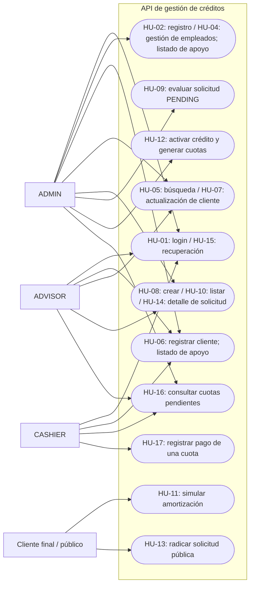
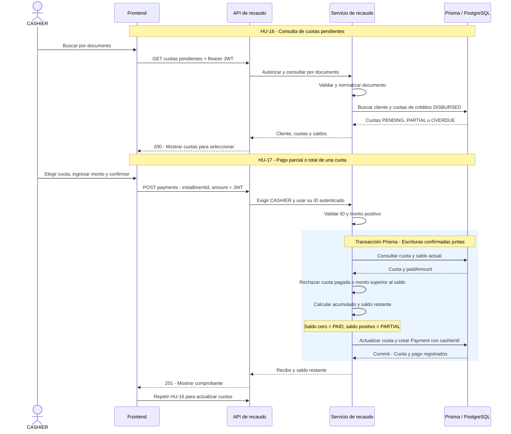
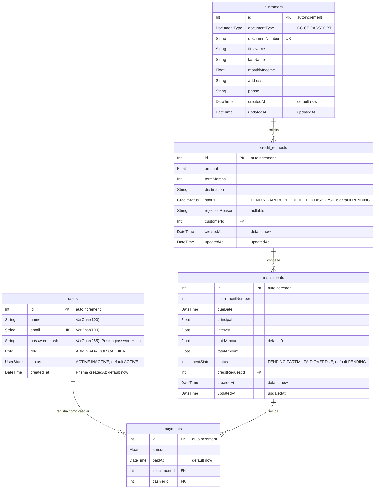
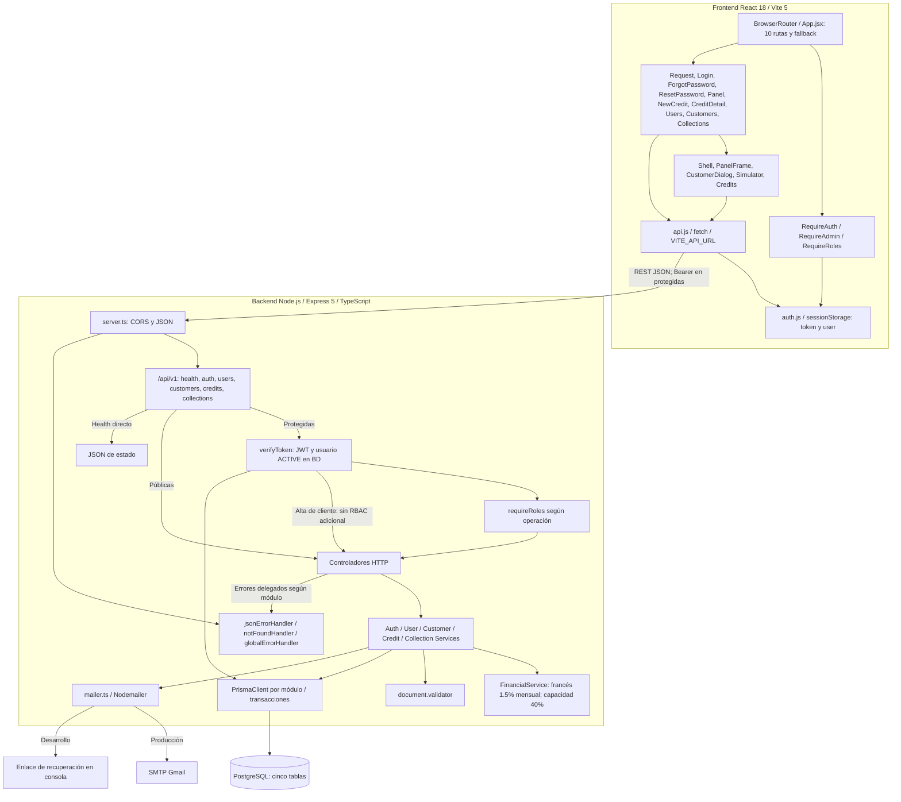
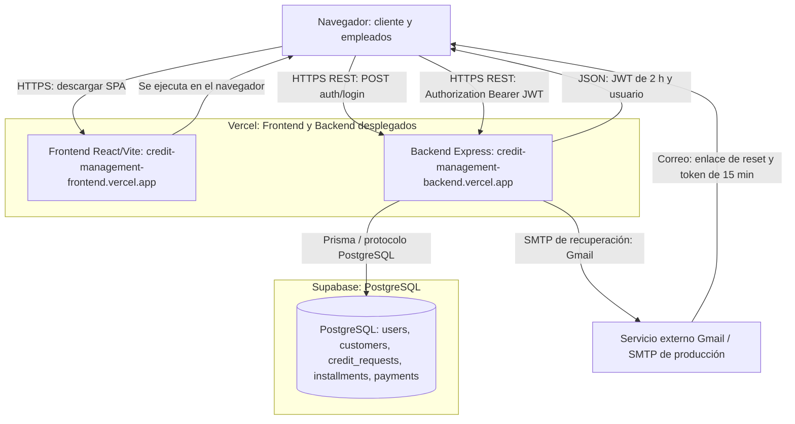

# Diagramas del sistema de gestión de créditos

La arquitectura del sistema integra Frontend React/Vite en Vercel, Backend Express en Vercel, PostgreSQL en Supabase y correo SMTP. Los diagramas describen los actores, el flujo de recaudo, las entidades y los componentes de nuestra solución. Versión: 20 de noviembre de 2026.

## 1. Casos de uso

Permisos de API, no menú UI: CASHIER puede registrar/listar clientes mediante API; la pantalla Clientes solo admite ADMIN/ADVISOR. La pantalla Cobros solo admite CASHIER aunque HU-16 permite los tres roles. Simulación y solicitud públicas también son accesibles sin sesión a cualquier visitante. No existe rol CLIENT en Prisma. HU-03 corresponde a la protección JWT/RBAC transversal a las operaciones protegidas, representada en componentes y secuencia. Identificadores contrastados con la [exportación Jira](JIRA_TRACEABILITY.md).

## 2. Secuencia crítica HU-16 y HU-17

La secuencia presenta el recorrido exitoso de consulta y pago. **API** agrupa rutas, middlewares JWT/RBAC y controlador; **Servicio** corresponde a collection.service. Cada petición protegida verifica el token y consulta el estado y rol actuales del usuario en base de datos.

**Rutas:** base `/api/v1/collections`; HU-16 usa `GET /customers/:documentNumber/pending-installments` y HU-17 usa `POST /payments`.

**Reglas conservadas:** HU-16 permite ADMIN, ADVISOR y CASHIER en la API; el recorrido de la pantalla Cobros corresponde a CASHIER. La consulta calcula el saldo pendiente y ordena cuotas por vencimiento dentro de cada crédito. El pago actúa sobre una sola cuota y toma el cajero de la sesión. La transacción consulta la cuota, valida su saldo, actualiza paidAmount/estado y crea Payment antes de confirmar. Las cuotas PAID dejan de aparecer en la consulta.

**Excepciones:** 400 por datos o reglas de saldo; 401 por autenticación; 403 por rol; 404 por cliente o cuota inexistente; 500 por fallo interno. Un rechazo detiene la operación: si ocurre dentro de la transacción, las escrituras se revierten. La interfaz exige revisar o refrescar las cuotas cuando el resultado del pago es incierto. Los controles de concurrencia e idempotencia se gestionan como riesgos operativos, independientes de la atomicidad de la transacción.

## 3. Entidad-relación: esquema Prisma actual

Se muestran nombres físicos de tablas y columnas (incluidos `password_hash` y `created_at` mapeados), tipos Prisma y cardinalidades. `String` sin anotación nativa corresponde a texto PostgreSQL; Float representa doble precisión, no decimal monetario. Las relaciones son obligatorias del lado FK y las colecciones pueden estar vacías. Este diagrama refleja `schema.prisma`, el modelo de datos que registra el historial de migraciones.

No hay relación del asesor/administrador con CreditRequest ni tabla de tenant. Tampoco hay unicidad declarada para `(creditRequestId, installmentNumber)`. Los enums son tipos, no tablas adicionales.

## 4. Componentes: arquitectura observada

Auth y Collection controllers responden sus errores directamente; otros delegan al middleware global. Los middlewares JWT/RBAC también pueden responder sin llegar al controlador. No existe capa Repository separada, bus de eventos o cola. Las rutas públicas omiten JWT; se procesan sin autenticación.

## 5. Arquitectura cloud — Bonus 1

El sistema está desplegado en Vercel: [Frontend](https://credit-management-frontend.vercel.app/) y [Backend](https://credit-management-backend.vercel.app/). La API usa PostgreSQL en Supabase. Utilizamos PostgreSQL local para desarrollo y organizamos el trabajo en cuatro Sprints de Jira. El Frontend incluye rewrite SPA a index.html. Las opciones específicas del proyecto Vercel y de conexión Supabase se administran en sus respectivos entornos; no se publican credenciales.

La SPA llama a la API desde el navegador, no desde el hosting estático. El Backend consulta usuario activo y rol en PostgreSQL para cada operación protegida; no delega autenticación a Supabase Auth. DATABASE_URL y DIRECT_URL son configuración de Prisma; el uso de pooler, TLS y la topología final se administran por entorno y se revisan como parte de la operación. El token de recuperación tiene propósito y secreto distintos del token de sesión.
