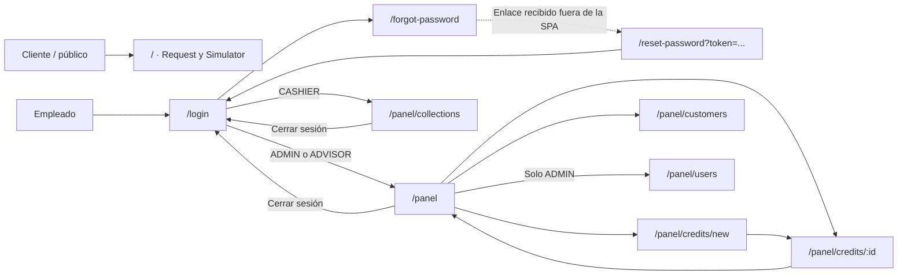

## 15. Flujo de Navegación y Vistas del Frontend

El Frontend utiliza React 18, React Router 6 y Vite 5. Tiene diez rutas explícitas y un fallback `*` que redirige a `/`. La siguiente guía describe la composición, las acciones y los estados de sus pantallas implementadas. Fuentes técnicas: `src/App.jsx`, `src/pages/*`, `src/CustomerDialog.jsx`, `src/Simulator.jsx`, `src/PanelFrame.jsx`, `src/auth.js`, `src/api.js` y `src/styles.css`.

| Ruta y componente | Actor | Composición y acciones reales | Estados a capturar para el mockup |
|---|---|---|---|
| `/` — Request | Público | Shell con panel ilustrado y formulario en tres pasos: Tus datos; Contacto e ingresos; Tu crédito. Tipo/documento, nombres, teléfono/dirección opcionales, ingreso, monto, plazo, destino opcional; simulador, consentimiento y envío | Validación por paso, simulación/cronograma, envío, error y confirmación con número de solicitud; no es portal de consulta |
| `/login` — Login | Público; acceso del equipo interno | Correo, contraseña, mostrar/ocultar, Entrar y enlace de recuperación; redirige según rol tras guardar sesión | Error, enviando, mensaje expired=1 o reset=1; sesión válida redirige al inicio del rol |
| `/forgot-password` — ForgotPassword | Público | Correo y Enviar enlace; vuelta a login | Enviando, error y confirmación genérica “Revisa tu correo” |
| `/reset-password` — ResetPassword | Público con enlace | Token leído de query y retirado de URL; nueva contraseña y confirmación, mostrar/ocultar; éxito vuelve a login?reset=1 | Enlace no válido/expirado, contraseñas distintas, error de servidor y guardando |
| `/panel` — Panel + Credits | ADMIN, ADVISOR | PanelFrame con identidad/cierre de sesión y pestañas; filtros Todas/Pendientes/Aprobadas/Desembolsadas/Rechazadas; búsqueda local por nombre/documento, tabla y nueva solicitud | Carga, error, vacío, resultados y acceso a Revisar/Ver detalle; PENDING es filtro inicial |
| `/panel/credits/new` — NewCredit | ADMIN, ADVISOR | Dos áreas: búsqueda de cliente por documento y datos de crédito; modal para crear cliente ausente; monto/plazo/destino y Simulator; advertencia de capacidad | Cliente ausente/encontrado, datos deshabilitados hasta hallarlo, validación, advertencia >40%, guardando y redirección al detalle |
| `/panel/credits/:id` — CreditDetail | ADMIN, ADVISOR | Estado, monto, plazo, datos de cliente y destino; edición de cliente; ADMIN aprueba/rechaza PENDING o confirma desembolso APPROVED; cronograma de cuotas | Carga/404/error, rechazo con motivo, error de capacidad, confirmación de desembolso, REJECTED y DISBURSED; ADVISOR consulta sin decidir |
| `/panel/users` — Users | ADMIN | Tabla de empleado/correo, rol, estado, fecha y acciones; modal alta/edición; confirmar desactivación y activar | Carga/error, validación de contraseña/email, cuenta propia marcada “Tú”; UI bloquea cambio de rol propio y autodesactivación |
| `/panel/customers` — Customers | ADMIN, ADVISOR | Tabla, búsqueda local por nombre/documento y CustomerDialog de alta/edición | Carga/error/vacío, validación, documento/tipo deshabilitados al editar y confirmación de guardado mediante recarga |
| `/panel/collections` — Collections | CASHIER | Buscar documento, resumen cliente, cuotas agrupadas por crédito, selector de cuota; ingreso de monto o “Usar saldo completo”; diálogo de confirmación y recibo | Sin búsqueda, carga, cliente ausente/sin cuotas, abono, pago completo, error/sobrepago, guardando y recibo; tras resultado incierto exige refrescar |

`Credits.jsx` es un componente de `/panel`, no una ruta `/credits` del Frontend. `CustomerDialog` y `Simulator` son componentes reutilizados, sin URL propia. PanelFrame muestra Cobros a CASHIER; Solicitudes/Clientes a ADMIN y ADVISOR; Usuarios solo a ADMIN. Cerrar sesión limpia `sessionStorage` y lleva a `/login`.

La conexión punteada representa el enlace de correo, no un enlace de navegación mostrado por ForgotPassword. RequireAuth comprueba expiración local y programa salida; un 401 con token limpia sesión desde api.js. Los guardas de rol usan el usuario almacenado localmente; el Backend vuelve a comprobar el usuario en BD.

### Limitaciones actuales y mejoras futuras

La actualización persistida del cliente comprende ingresos, dirección y teléfono. La evolución de la interfaz contempla alinear los campos editables y las reglas de validación con la API, y registrar el consentimiento del formulario público en el servidor. Los permisos de navegación y los permisos de API se describen por separado en esta memoria porque su alcance es diferente.

El diseño visual se implementa mediante `styles.css`, Shell y PanelFrame. La guía de pantallas permite representar el recorrido público y los recorridos internos por rol, junto con sus estados de carga, validación, confirmación y error.

### Capturas de pantalla del producto

Cada espacio identifica la ruta y el perfil de la vista correspondiente. Las capturas se incorporan con datos de demostración y sin tokens o credenciales.

#### C01 · `/` · Público

> **[INSERTAR CAPTURA C01: Formulario público: datos, contacto/ingresos, simulación y confirmación]**

#### C02 · `/login` · Público

> **[INSERTAR CAPTURA C02: Inicio de sesión con campos de correo y contraseña]**

#### C03 · `/forgot-password` · Público

> **[INSERTAR CAPTURA C03: Solicitud de enlace y confirmación genérica]**

#### C04 · `/reset-password` · Público

> **[INSERTAR CAPTURA C04: Nueva contraseña, confirmación y estado de enlace inválido]**

#### C05 · `/panel` · ADMIN y ADVISOR

> **[INSERTAR CAPTURA C05: Listado de solicitudes, filtros y búsqueda]**

#### C06 · `/panel/credits/new` · ADMIN y ADVISOR

> **[INSERTAR CAPTURA C06: Búsqueda de cliente y formulario de nueva solicitud]**

#### C07 · `/panel/credits/:id` · ADMIN y ADVISOR

> **[INSERTAR CAPTURA C07: Detalle y cronograma; acciones de evaluación/desembolso en variante ADMIN]**

#### C08 · `/panel/users` · ADMIN

> **[INSERTAR CAPTURA C08: Listado de empleados y formulario de creación o edición]**

#### C09 · `/panel/customers` · ADMIN y ADVISOR

> **[INSERTAR CAPTURA C09: Listado de clientes y formulario de contacto e ingresos]**

#### C10 · `/panel/collections` · CASHIER

> **[INSERTAR CAPTURA C10: Consulta de cuotas, confirmación de pago y recibo]**
