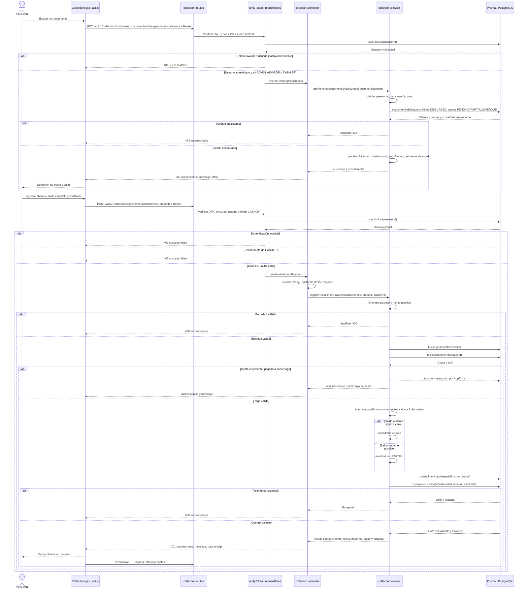

# Secuencia tecnica detallada de recaudo

Referencia de mantenimiento; para Confluence usar la secuencia resumida de DIAGRAMS.md.

## 2. Secuencia crítica HU-16 y HU-17

La transacción asegura que actualización de cuota y creación del pago se confirmen juntas. No implica bloqueo explícito ni idempotencia; el control de operaciones concurrentes y reintentos se contempla en los riesgos operativos. HU-16 no marca OVERDUE según fecha. La UI impide nuevos envíos mientras paga y exige refrescar tras errores inciertos. Una búsqueda sin cuotas devuelve 200 con colecciones vacías. No hay generación de PDF ni pasarela.

