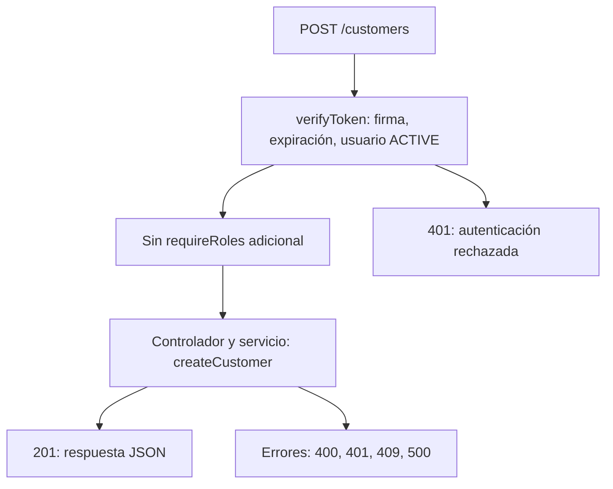

# Registrar cliente

**Trazabilidad Jira:** HU-06 · SCRUM-10 · SCRUM Sprint 2 · Finalizada.

**Entrada:** `POST /api/v1/customers`. **Actor:** ADMIN, ADVISOR, CASHIER.

**Evidencia:** `src/server.ts`, `src/routes/v1/`; src/controllers/customer.controller.ts; src/services/customer.service.ts; src/utils/document.validator.ts.

**Flujo:** el router recibe la solicitud, verifica JWT y usuario activo en BD. Solo verifyToken: no hay restricción RBAC adicional. CC/CE: 6–10 dígitos; PASSPORT: 6–12 alfanuméricos. Teléfono: 7–15 dígitos. El controlador construye la respuesta 201; los errores se resuelven según el controlador y los middlewares documentados en la referencia REST.

**Entrada, respuesta y excepciones:** [contrato y ejemplos](../API_REFERENCE.md). Consulte también la operación `createCustomer` en [OpenAPI](../openapi.yaml).

