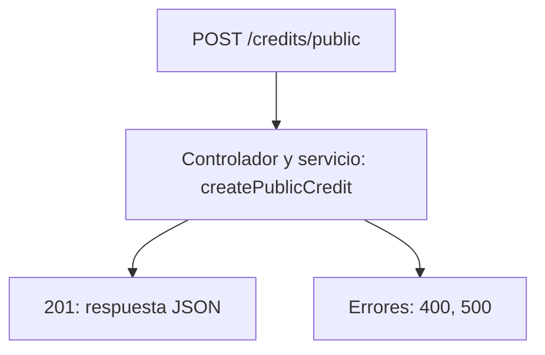

# Solicitar crédito público

**Trazabilidad Jira:** HU-13 · SCRUM-39 · SCRUM Sprint 3 · Finalizada.

**Entrada:** `POST /api/v1/credits/public`. **Actor:** público.

**Evidencia:** `src/server.ts`, `src/routes/v1/`; src/controllers/credit.controller.ts; src/services/credit.service.ts; src/services/financial.service.ts.

**Flujo:** el router recibe la solicitud. Crea cliente si no existe; si existe no modifica sus datos. documentType=CC, address=No registrada, phone vacío y destination=Libre inversión por defecto. Cliente y solicitud se crean sin transacción conjunta. El controlador construye la respuesta 201; los errores se resuelven según el controlador y los middlewares documentados en la referencia REST.

**Entrada, respuesta y excepciones:** [contrato y ejemplos](../API_REFERENCE.md). Consulte también la operación `createPublicCredit` en [OpenAPI](../openapi.yaml).

