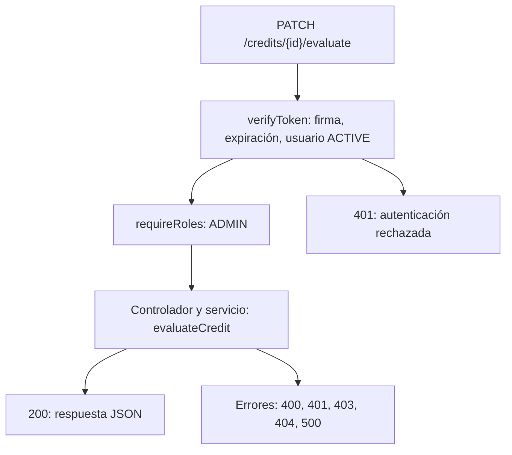

# Evaluar solicitud

**Trazabilidad Jira:** HU-09 · SCRUM-14 · SCRUM Sprint 3 · Finalizada.

**Entrada:** `PATCH /api/v1/credits/{id}/evaluate`. **Actor:** ADMIN.

**Evidencia:** `src/server.ts`, `src/routes/v1/`; src/controllers/credit.controller.ts; src/services/credit.service.ts; src/services/financial.service.ts.

**Flujo:** el router recibe la solicitud, verifica JWT y usuario activo en BD, y autoriza el rol actual. Solo PENDING; rechazo exige rejectionReason no vacío; aprobación exige cuota francesa <= 40% de monthlyIncome. El controlador construye la respuesta 200; los errores se resuelven según el controlador y los middlewares documentados en la referencia REST.

**Entrada, respuesta y excepciones:** [contrato y ejemplos](../API_REFERENCE.md). Consulte también la operación `evaluateCredit` en [OpenAPI](../openapi.yaml).

