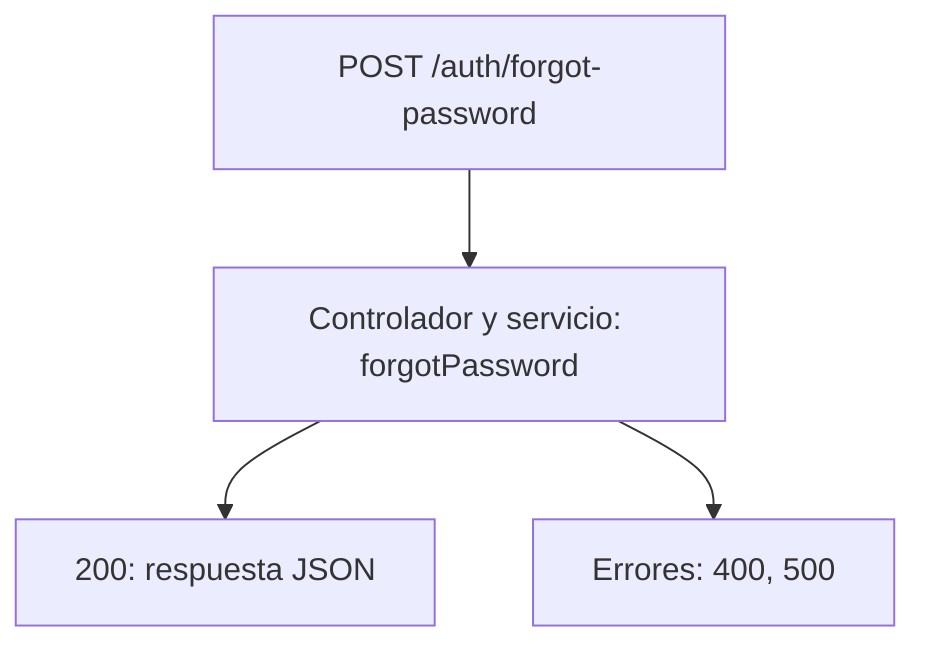

# Solicitar recuperación

**Trazabilidad Jira:** HU-15 · SCRUM-42 · SCRUM Sprint 4 · Finalizada.

**Entrada:** `POST /api/v1/auth/forgot-password`. **Actor:** público.

**Evidencia:** `src/server.ts`, `src/routes/v1/`; src/controllers/auth.controller.ts; src/services/auth.service.ts; src/utils/mailer.ts.

**Flujo:** el router recibe la solicitud. Respuesta genérica para correo inexistente o inactivo; JWT de recuperación de 15 minutos. SMTP solo en NODE_ENV=production. El controlador construye la respuesta 200; los errores se resuelven según el controlador y los middlewares documentados en la referencia REST.

**Entrada, respuesta y excepciones:** [contrato y ejemplos](../API_REFERENCE.md). Consulte también la operación `forgotPassword` en [OpenAPI](../openapi.yaml).

