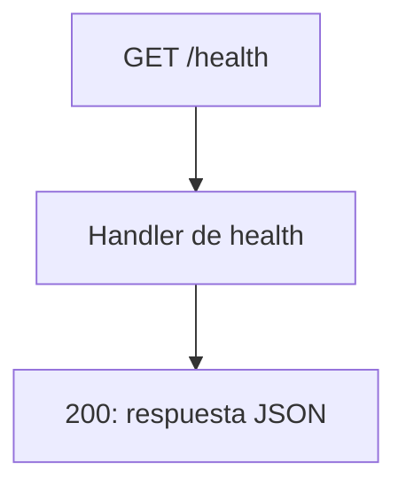

# Estado de API

**Entrada:** `GET /api/v1/health`. **Actor:** público.

**Evidencia:** `src/server.ts`, `src/routes/v1/`; src/routes/v1/index.ts.

**Flujo:** el router recibe la solicitud. No consulta la base de datos. El controlador construye la respuesta 200; devuelve el estado sin acceder a Prisma.

**Entrada, respuesta y excepciones:** [contrato y ejemplos](../API_REFERENCE.md). Consulte también la operación `health` en [OpenAPI](../openapi.yaml).

