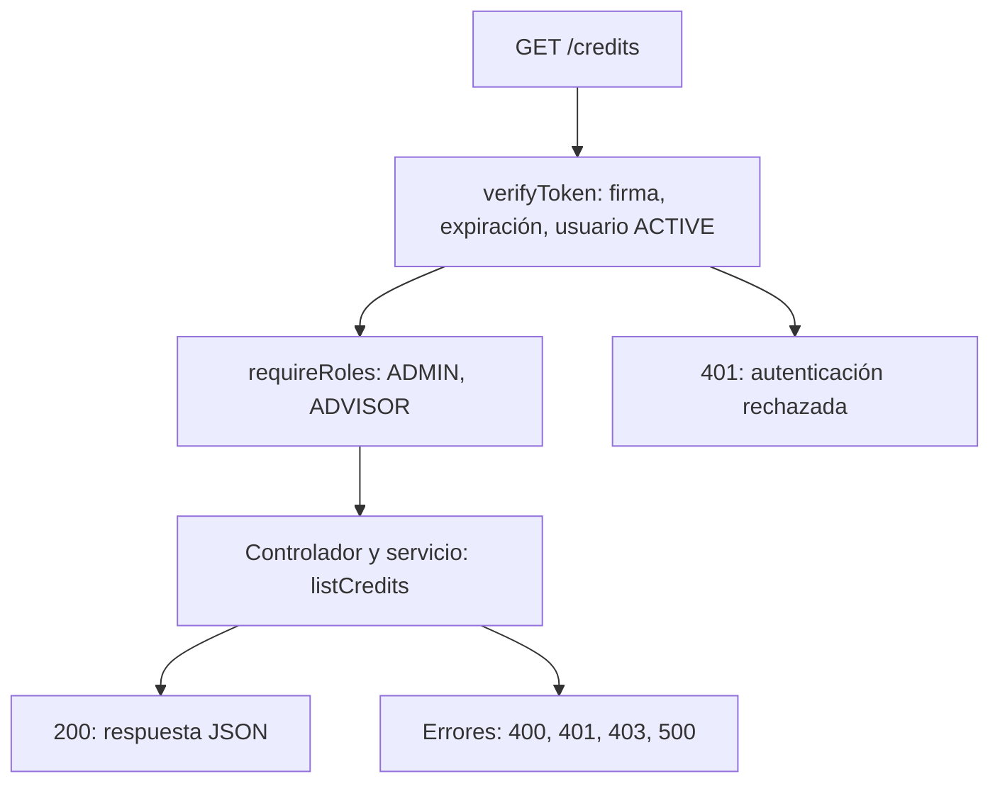

# Listar solicitudes

**Trazabilidad Jira:** HU-10 · SCRUM-15 · SCRUM Sprint 3 · Finalizada.

**Entrada:** `GET /api/v1/credits`. **Actor:** ADMIN, ADVISOR.

**Evidencia:** `src/server.ts`, `src/routes/v1/`; src/controllers/credit.controller.ts; src/services/credit.service.ts; src/services/financial.service.ts.

**Flujo:** el router recibe la solicitud, verifica JWT y usuario activo en BD, y autoriza el rol actual. Filtros opcionales status y documentNumber; status se convierte a mayúsculas, documento solo trim. Orden descendente por createdAt. El controlador construye la respuesta 200; los errores se resuelven según el controlador y los middlewares documentados en la referencia REST.

**Entrada, respuesta y excepciones:** [contrato y ejemplos](../API_REFERENCE.md). Consulte también la operación `listCredits` en [OpenAPI](../openapi.yaml).

