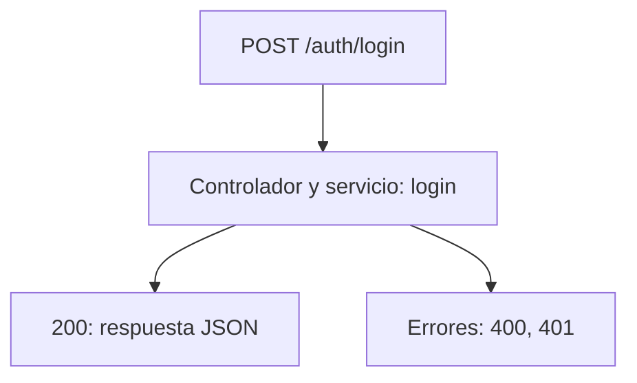

# Iniciar sesión

**Trazabilidad Jira:** HU-01 · SCRUM-7 · SCRUM Sprint 1 · Finalizada.

**Entrada:** `POST /api/v1/auth/login`. **Actor:** público.

**Evidencia:** `src/server.ts`, `src/routes/v1/`; src/controllers/auth.controller.ts; src/services/auth.service.ts; src/utils/mailer.ts.

**Flujo:** el router recibe la solicitud. JWT de 2 horas con userId y role. Todos los errores capturados por este controlador se convierten en 401. El controlador construye la respuesta 200; los errores se resuelven según el controlador y los middlewares documentados en la referencia REST.

**Entrada, respuesta y excepciones:** [contrato y ejemplos](../API_REFERENCE.md). Consulte también la operación `login` en [OpenAPI](../openapi.yaml).

