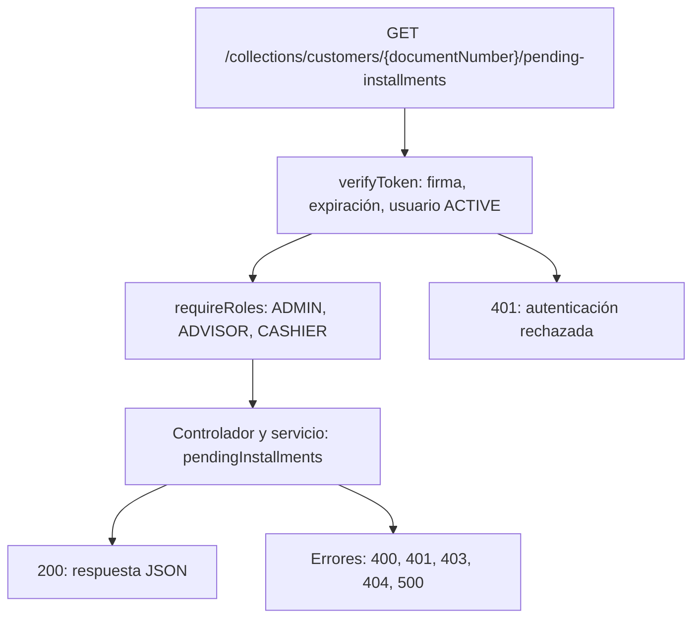

# HU-16: consultar cuotas pendientes

**Trazabilidad Jira:** HU-16 · SCRUM-18 · SCRUM Sprint 4 · Finalizada.

**Entrada:** `GET /api/v1/collections/customers/{documentNumber}/pending-installments`. **Actor:** ADMIN, ADVISOR, CASHIER.

**Evidencia:** `src/server.ts`, `src/routes/v1/`; src/controllers/collection.controller.ts; src/services/collection.service.ts.

**Flujo:** el router recibe la solicitud, verifica JWT y usuario activo en BD, y autoriza el rol actual. Solo créditos DISBURSED y cuotas PENDING/PARTIAL/OVERDUE, ordenadas por dueDate dentro de cada crédito. Documento trim y mayúsculas, sin regex adicional. El controlador construye la respuesta 200; los errores se resuelven según el controlador y los middlewares documentados en la referencia REST.

**Entrada, respuesta y excepciones:** [contrato y ejemplos](../API_REFERENCE.md). Consulte también la operación `pendingInstallments` en [OpenAPI](../openapi.yaml).

El diagrama detallado de persistencia se encuentra en [DIAGRAMS.md](../DIAGRAMS.md).
