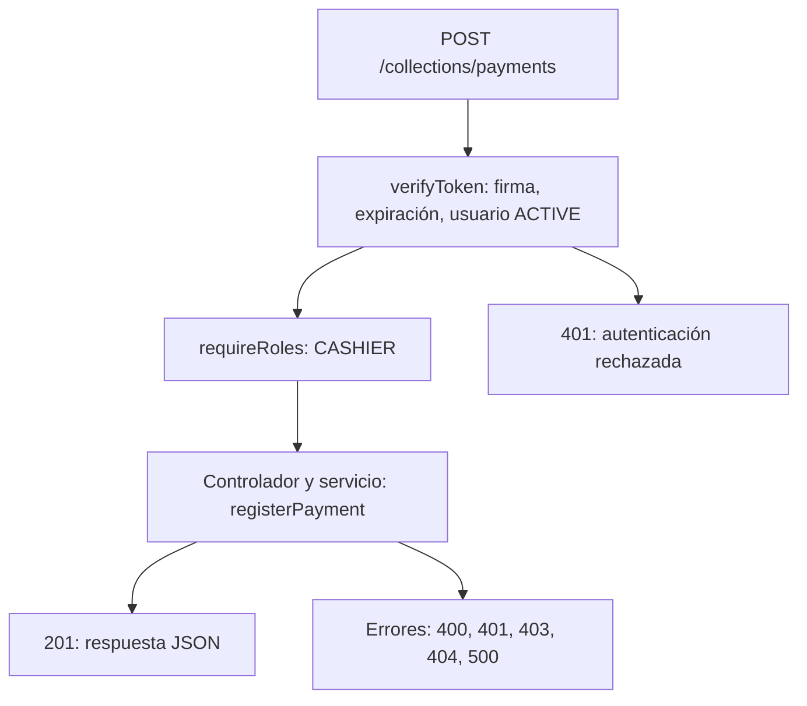

# HU-17: registrar pago

**Trazabilidad Jira:** HU-17 · SCRUM-19 · SCRUM Sprint 4 · Finalizada.

**Entrada:** `POST /api/v1/collections/payments`. **Actor:** CASHIER.

**Evidencia:** `src/server.ts`, `src/routes/v1/`; src/controllers/collection.controller.ts; src/services/collection.service.ts.

**Flujo:** el router recibe la solicitud, verifica JWT y usuario activo en BD, y autoriza el rol actual. Convierte installmentId y amount con Number. cashierId proviene del usuario autenticado, nunca del body. Pago por una cuota; monto <= saldo pendiente; saldo cero => PAID, de otro modo PARTIAL. El controlador construye la respuesta 201; los errores se resuelven según el controlador y los middlewares documentados en la referencia REST.

**Entrada, respuesta y excepciones:** [contrato y ejemplos](../API_REFERENCE.md). Consulte también la operación `registerPayment` en [OpenAPI](../openapi.yaml).

El diagrama detallado de persistencia se encuentra en [DIAGRAMS.md](../DIAGRAMS.md).
