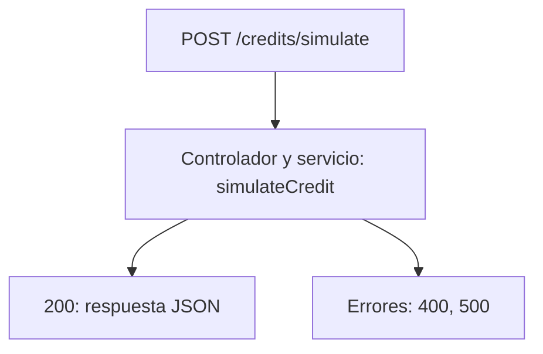

# Simular amortización

**Trazabilidad Jira:** HU-11 · SCRUM-16 · SCRUM Sprint 3 · Finalizada.

**Entrada:** `POST /api/v1/credits/simulate`. **Actor:** público.

**Evidencia:** `src/server.ts`, `src/routes/v1/`; src/controllers/credit.controller.ts; src/services/credit.service.ts; src/services/financial.service.ts.

**Flujo:** el router recibe la solicitud. Sistema francés, tasa mensual fija 1.5%. Convierte amount y termMonths con Number; no impone el máximo de monto de creación. El controlador construye la respuesta 200; los errores se resuelven según el controlador y los middlewares documentados en la referencia REST.

**Entrada, respuesta y excepciones:** [contrato y ejemplos](../API_REFERENCE.md). Consulte también la operación `simulateCredit` en [OpenAPI](../openapi.yaml).

