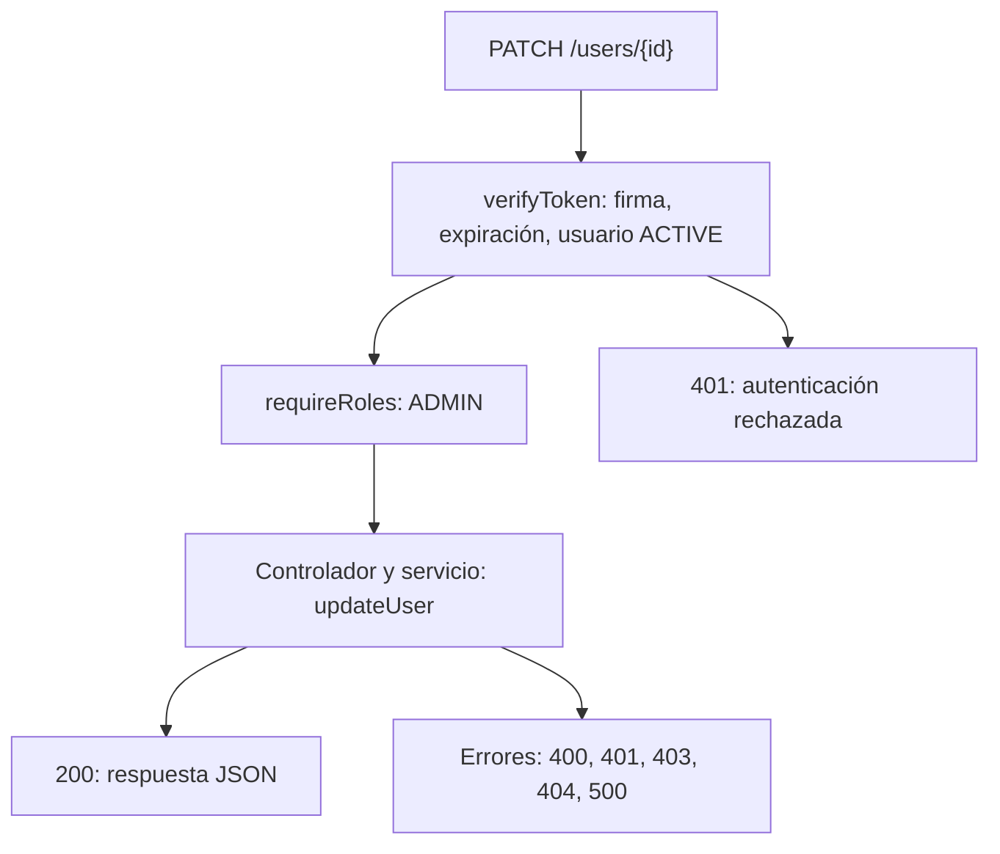

# Actualizar empleado

**Trazabilidad Jira:** HU-04 · SCRUM-9 · SCRUM Sprint 1 · Finalizada.

**Entrada:** `PATCH /api/v1/users/{id}`. **Actor:** ADMIN.

**Evidencia:** `src/server.ts`, `src/routes/v1/`; src/controllers/user.controller.ts; src/services/user.service.ts.

**Flujo:** el router recibe la solicitud, verifica JWT y usuario activo en BD, y autoriza el rol actual. Impide la autodesactivación; permite cambiar name, role, status. El controlador construye la respuesta 200; los errores se resuelven según el controlador y los middlewares documentados en la referencia REST.

**Entrada, respuesta y excepciones:** [contrato y ejemplos](../API_REFERENCE.md). Consulte también la operación `updateUser` en [OpenAPI](../openapi.yaml).

